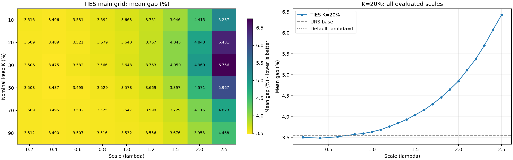

# 五个 URS 专家的 TIES-Merging 结果

72 个合并配置均已完成五任务评测：66 个 TIES、1 个等权平均、5 个额外 TA。所有 gap 单位为 %，越低越好；均值是五任务等权平均，差值单位为百分点。

| 模型 | CVRP | CVRPB | CVRPTW | OCVRP | OCVRPTW | 均值 | 相对 base（百分点） | 改善任务数 |
| --- | --- | --- | --- | --- | --- | --- | --- | --- |
| 论文 URS（四舍五入） | 1.81 | 1.46 | 6.13 | 3.24 | 5.07 | 3.542 | — | — |
| 本地 base（微调实验时） | 1.812774 | 1.457159 | 6.129026 | 3.244275 | 5.072808 | 3.543209 | +0.000000 | 0/5 |
| 本地 base（本轮） | 1.812774 | 1.457159 | 6.129026 | 3.244275 | 5.072808 | 3.543209 | +0.000000 | 0/5 |
| 默认 TIES：K=20%，λ=1 | 2.015897 | 1.808726 | 6.060034 | 3.169558 | 5.147547 | 3.640352 | +0.097144 | 2/5 |
| 最佳 TIES：K=30%，λ=0.4 | 1.810002 | 1.498856 | 5.985793 | 3.128313 | 4.953341 | 3.475261 | -0.067948 | 4/5 |
| 五项均改善的最佳 TIES：K=90%，λ=0.4 | 1.786728 | 1.431077 | 6.063800 | 3.145279 | 5.024888 | 3.490354 | -0.052854 | 5/5 |
| 五专家等权平均 | 1.826658 | 1.505962 | 6.028059 | 3.172195 | 4.989161 | 3.504407 | -0.038802 | 3/5 |
| 最佳 TA：λ=0.2 | 1.826658 | 1.505962 | 6.028059 | 3.172195 | 4.989161 | 3.504407 | -0.038802 | 3/5 |
| 对应任务专家（五模型参考） | 1.680634 | 1.322779 | 5.683701 | 3.135779 | 5.010008 | 3.366580 | -0.176628 | 5/5 |

完整网格中，22/66 个 TIES 配置的平均 gap 优于 base，其中 7 个配置五项任务均改善。在本次网格内，六种名义保留比例各自的最佳 λ 均为 0.4。

默认 TIES 平均 gap 为 3.640352%，相对本轮 base 为 +0.097144 个百分点，改善 2/5 项任务；最坏退化为 0.351567 个百分点。

探索性最佳 TIES 平均 gap 为 3.475261%，相对 base 为 -0.067948 个百分点，改善 4/5 项任务；最坏退化为 0.041697 个百分点。相对等权平均的均值差为 -0.029146 个百分点。

补充展示：五项任务均优于 base 的 TIES 配置中，按平均 gap 最小、平分按配置 ID 选择，得到 K=90%、λ=0.4，平均 gap 为 3.490354%，相对 base 为 -0.052854 个百分点。这仍是同一数据上的探索性结果，不替换预先固定的平均 gap 主选择标准。

五个专家的完整交叉评测如下，粗体为其微调任务。专家对角线来自五个不同模型，不能视为一个多任务模型的结果。

| 模型 | CVRP | CVRPB | CVRPTW | OCVRP | OCVRPTW | 均值 |
| --- | --- | --- | --- | --- | --- | --- |
| CVRP 微调专家 | **1.680634** | 1.767453 | 6.337476 | 3.577126 | 5.409264 | 3.754391 |
| CVRPB 微调专家 | 1.897565 | **1.322779** | 6.091157 | 3.270368 | 5.162637 | 3.548901 |
| CVRPTW 微调专家 | 1.929292 | 1.641127 | **5.683701** | 3.439193 | 5.100948 | 3.558852 |
| OCVRP 微调专家 | 2.334288 | 2.066791 | 6.271890 | **3.135779** | 5.319238 | 3.825597 |
| OCVRPTW 微调专家 | 1.936522 | 1.819382 | 6.373931 | 3.572494 | **5.010008** | 3.742467 |

默认 TIES 是预先固定的免调参设置。最佳 TIES 与最佳 TA 都按同一原始评测数据上的五任务平均 gap 最小选择，平分时按配置 ID 排序；它们是探索性结果，不是独立测试集上的泛化结论，也不宣称统计显著。每个合并模型五任务共用同一份权重和参数。

沿用 URS 原数据各前 1000 例、N=100、seed=3407、greedy、8 倍增强、batch=125；CVRPB 保持原 80 个 POMO 起点，其余任务 100 个。正式表优先采用 4090 confirm；未经 confirm 的配置保留其扫描结果。所有校准、扫描和复核数值均保留在长表中。

TA 的候选包含 λ=0.2 对应的等权平均；二者数学等价，但 FP32 逐项平均与 base+任务增量之和的计算顺序可能导致舍入差异。

| 代表结果 | 配置 ID | 采用结果 | GPU |
| --- | --- | --- | --- |
| base | base | base__4090 | NVIDIA GeForce RTX 4090 / 0 |
| default | ties_k20_l1p0 | confirm_ties_k20_l1p0 | NVIDIA GeForce RTX 4090 / 1 |
| best_ties | ties_k30_l0p4 | confirm_ties_k30_l0p4 | NVIDIA GeForce RTX 4090 / 0 |
| average | average | confirm_average | NVIDIA GeForce RTX 4090 / 0 |
| best_ta | average | confirm_average | NVIDIA GeForce RTX 4090 / 0 |
| best_all_tasks_ties | ties_k90_l0p4 | confirm_ties_k90_l0p4 | NVIDIA GeForce RTX 4090 / 1 |

参数图中的 K 是名义保留比例：本轮 K=90% 时因阈值为 0 且存在并列，官方 `>=` 规则得到的五专家阈值掩码均为 100%（原本为 0 的增量仍为 0），因此不能解读为严格保留 90%；详见 [merge_diagnostics.json](merge_diagnostics.json)。

这里的最佳配置指本次预设网格中按扫描结果选出、再经 4090 复核的配置；其余候选保留各自扫描硬件的数值。
主配置扫描均值为 3.475155422%，4090 复核为 3.475260869%。四个代表配置复核中，单任务 gap 最大差异为 0.000527234444 个百分点，来自 K=30%、λ=0.4 的 OCVRPTW；其余代表配置的任务 gap 一致。最终数值、协议与模型哈希核验见 [final_verification.json](final_verification.json)。

完整配置与指标：[summary.csv](summary.csv)；全部原始结果及来源：[all_results.csv](all_results.csv)；代表配置、模型路径及数值：[summary.json](summary.json)；[PDF 图](heatmap.pdf)。
