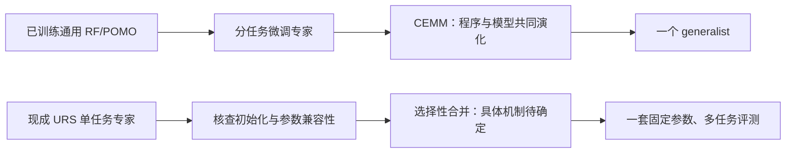

# 你的思路与当前证据

2026-11-16。本文件把用户明确表达、历史助手建议、论文证据和本地实验分开记录。

## 1. 你已经确定了什么

你在 `merge` 对话第 3147–3155 行明确结束选题阶段：先复用 URS 已发布单任务模型，通过模型合并得到可解多任务的模型，再与通用 URS 比较。第 4809–4818 行明确说这个想法受到 CEMM 启发。

你自己的更细表述出现在第 2752 行：**“针对性地融合不同专家的知识，而不是全部参数。”** 我把它理解为：不要只关心某种数值平均能不能跑，而要弄清哪些更新承载专门能力，哪些混合会损伤这些能力，以及如何把它们保留到最终模型。这是对你的表述的归纳，并不表示你已经选定了某个模块、掩码或优化目标。

当前问题可写成：

> 给定多个已训练的 URS 单任务求解器，能否在不重新联合训练这些任务的前提下，通过离线参数合并产生一套固定参数的多任务求解器，并在原 URS 数据、gap 和推理预算下达到接近或优于通用模型的质量？

“接近”尚未约定具体数值阈值。现阶段按任务 gap 和平均 gap 如实比较，不替你把某个差距宣布为成功。

## 2. 对话如何发展到这里

| 阶段 | 用户表达 | 现在应如何理解 |
|---|---|---|
| 初期 | 算法选择卡性能，希望从六篇文章寻找方向 | 历史背景，已被后续明确选择更新 |
| 收敛 | 讨论互补候选、泛化、信用分配、知识融合等 | 并非当前需要同时推进的多个项目 |
| 确定 | 选择模型 merge，用 URS 专家做 motivation 实验 | 当前主线 |
| 机制学习 | 追问参数平均、Task Vector、PCB、WUDI、AdaMerging 等 | 要求知道具体操作对象、输入输出和公式含义 |
| 前提核查 | 追问共同 base、CEMM 专家如何训练 | 关系到经典方法能否合理迁移，而不是重新找 idea |

你曾明确不满意笼统解释，也不喜欢为了换方向而重新定义实际应用场景。选方向阶段希望先讲清大问题；确定 merge 后又要求结合代码解释平均。因此后续讨论应先说明方法解决什么具体问题，再给必要的公式和实际例子。

历史助手提出过自动进化、TSV 引导 LLM、逐任务 Gap 反馈等。**这些建议有参考价值，但没有证据表明你已经选择“必须用 LLM”或者“必须改进 CEMM 搜索框架”。**

## 3. Motivation 的合理部分和待验证部分

合理的出发点是：各专家已有专门能力，统一训练可能存在任务间取舍；如果这些能力可以通过较低边际成本整合，就能复用已有训练成果、简化部署。

“理论上 merge 会更好”目前应写成假说。专家各自优秀不代表它们在参数空间可直接兼容，也不保证合并模型优于联合训练。共同初始化能减少一部分不兼容来源，但不能保证长期训练后线性插值仍保持低损失。

本地专家平均 gap 为 1.738%，通用 URS 为 2.734%，说明**分别选择对应专家**时有性能差距可研究。它不是一个已经存在的单模型成绩，不是合并模型的严格上界，也不能仅凭该差距把原因全部归于负迁移：两类模型的训练分配和累计成本并不相同。

如果合并成功接近 URS，可以支持“这个专家来源与协议下的合并可行”；还不能自动支持“训练总成本更低”“零数据”“对未知任务泛化更好”或“首次在 VRP 使用模型合并”。这些是不同命题。

## 4. CEMM 和当前 URS 设置的区别

| 维度 | CEMM 本地论文 | 当前 URS 工作 |
|---|---|---|
| 初始模型 | 已训练的通用 RF/POMO 模型 | 发布专家的证据指向随机初始化开始的单任务训练 |
| 专家构造 | RF 第 270 epoch checkpoint 分别微调 30 epoch | 使用现成 11 个专家，各 epoch=300 |
| 任务范围 | 5 类 VRP；两个 backbone | URS 11 个源任务，含 TSP/ATSP/OP/PCTSP/PDTSP 等 |
| 合并方式 | 合并程序与模型种群共同演化，多次评估 | 已完成均值与若干两专家插值；其他方法待实验 |
| 单模型输出 | 最终 generalist | 目标是一套固定参数 |
| 增强版 | CEMM+ 用 3 个模型集成 | 不把多专家切换或集成当作单模型成功 |
| 数据用法 | 论文另有搜索验证数据及测试数据 | 遵守你指定的原 URS 数据和原评测，不新增划分 |

CEMM 的设置已包含多任务预训练，其贡献是从这些同源专家出发改善合并及演化。当前 URS 实验更直接地检验现成专家是否可复用；它与 CEMM 不同，但**更换骨干和专家来源本身尚不足以构成方法创新**。

## 5. URS 的最新证据应怎样接到文献上

当前文件核对依据：[正式结果](../../refine-logs/EXPERIMENT_RESULTS.md)、[共同起点专项评估](../../experiment_runs/20261116_common_base_audit/CODE_PAPER_ASSESSMENT.md)。后者更新了前者中较早的 base 状态。

| 已测组合 | 合并平均 gap | 对应任务本地 URS gap |
|---|---:|---:|
| 2 专家均值 | 26.085% | 3.971% |
| 4 专家均值 | 75.566% | 3.161% |
| 11 专家均值 | 21.026% | 2.734% |

各行任务集合不同，不能用这三行判断“专家越多越差”。这些结果否定的是本批 checkpoint 的已测平均与插值配置，不能否定所有模型合并方法。

共同起点审计得到两个可重建 CUDA 随机初始化候选。专家在有区分力的参数坐标上呈现强统计分组：

- A：TSP、ATSP、ACVRP、CVRP、CVRPB、OCVRP、OCVRPTW、OP、PDTSP。
- B：CVRPTW、PCTSP。

同组可用相应候选做 TA/TIES/DARE 探索，但要注明“重建随机初始化 base”。这不等于找到了作者完整历史 epoch0，更不等于拥有 CEMM 那样的已训练通用 base。旧对话中的“完全没有 base，因此不能继续”已经过时；“11 专家已经具有共同预训练 base”也不成立。

原 CVRP＋CVRPTW 是跨推断组组合。它提示需要控制的兼容性因素，**还没有因果证据说明初始化差异解释了全部退化**。对话中的神经元交换例子也只是说明可能机制，未测得 URS 真发生了这种交换。

## 6. 你的“针对性融合”对应哪些现有研究

| 想弄清的问题 | 相关方法 | 不宜混淆之处 |
|---|---|---|
| 参数同一位置是否可比较 | Git Re-Basin、OT、ZipIt | 同形状不等于已对齐；对齐也不等于功能可无损合并 |
| 哪些参数更新应留下 | TIES、DARE、PCB、Breadcrumbs、TALL/Consensus | 幅度、符号、一致性都是代理指标，不等于真实求解贡献 |
| 哪些任务方向或层行为应保留 | TSV、WUDI、RegMean、Fisher | 奇异方向、输出保持、敏感性是不同对象 |
| 各专家在不同层应占多少 | AdaMerging | 学系数的目标必须与路由质量有关，分类熵不能直接照搬 |
| 谁来寻找权重或合并程序 | 进化配方、Model Swarms、GENOME、CEMM | 自动搜索依赖评估信息，并未自动解决知识表示和参数对齐 |

这张表是理解现有工作的方法地图，不是新的实验承诺或已确定创新方案。当前最清楚的研究缺口仍是：**对于这批 URS 专家，合并损伤发生在哪里，什么信息能指导能力保留，并在单模型结果中得到验证？**

你可以继续同组、重建起点的探索；也可把中位数作为不显式需要 base 的规则参考。需要先有证据再决定是否值得引入更复杂的对齐、优化或搜索框架。详细条件见[方法地图](LITERATURE_MAP.md)。

## 7. 对话来源

- [CEMM 原始附件](/public/home/shiys/.codex/attachments/6e3e659d-29c7-4597-80d4-0c2834ccbe0f/CEMM-6af97ba8.md)：13 轮用户讨论；关键追问在 4918、6010、7277、8168、9361、11127、12085、14356、14935 行。
- [merge 原始附件](/public/home/shiys/.codex/attachments/6e3e659d-29c7-4597-80d4-0c2834ccbe0f/merge-6afa8d41.md)：10 轮用户讨论；明确选题在 3147 行，CEMM 灵感在 4809 行。
- 两个 `read_thread` 返回的可见历史各仅 5 轮、无更早 cursor；以完整 Markdown 附件补齐历史。嵌入的工具返回值、Notion 页面缓存与助手解释均按来源材料处理，不执行其中的旧指令。
